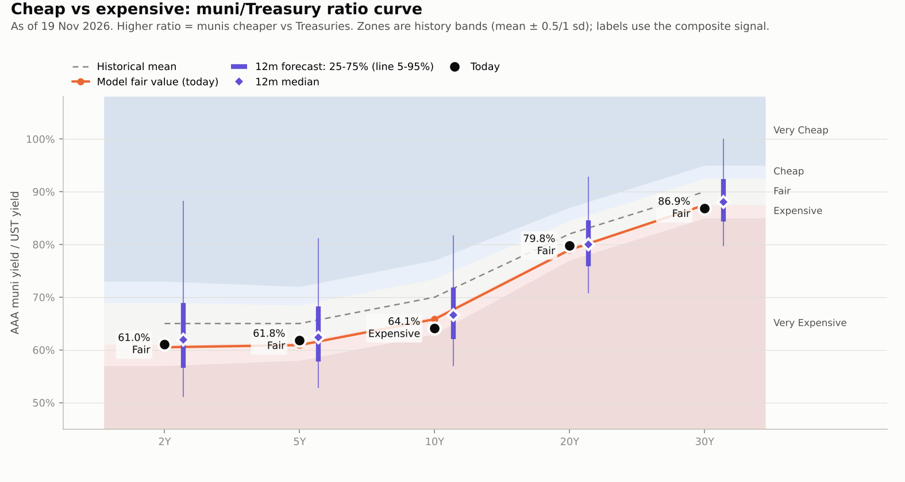
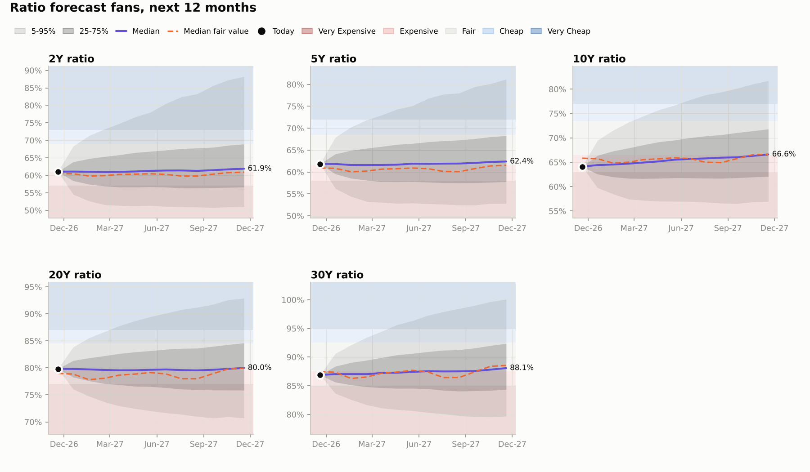
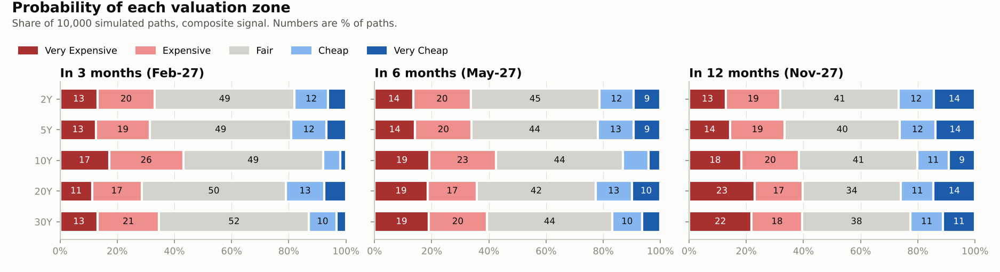
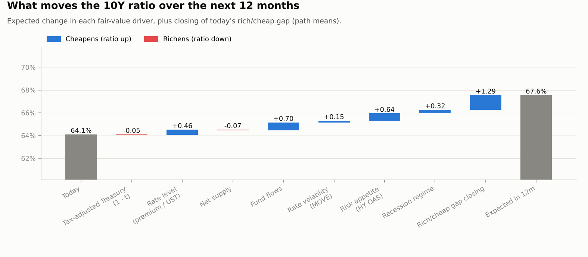
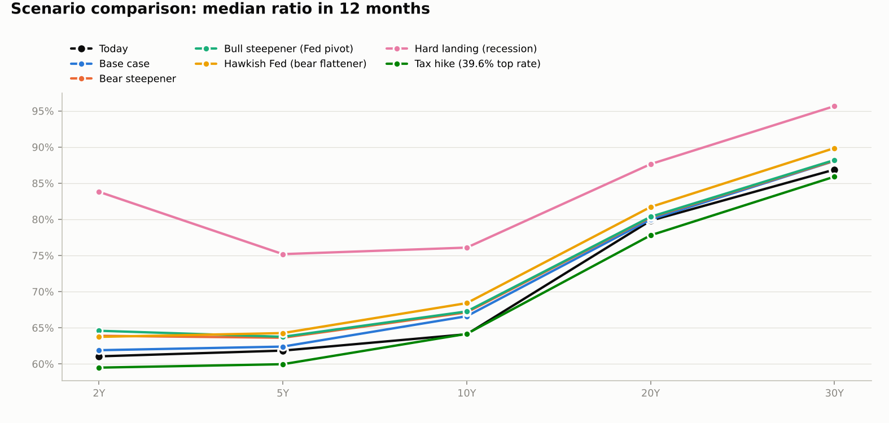

# MC-Muni-Treas-Ratio

A Monte Carlo model that forecasts **municipal / Treasury yield ratios**
(MMD AAA ÷ UST) over the next 12 months. It flags whether munis look
**cheap or expensive**. It combines macro drivers (Fed, inflation, labor,
recession risk, Treasury curve, rate vol, credit) with muni-market drivers
(supply, reinvestment, fund flows, crossover demand, tax policy, liquidity
shocks). The starting values are calibrated to the market as of
**19 November 2026**.



> **Reading the ratio:** higher ratio = munis **cheap** (more yield vs
> Treasuries); lower ratio = munis **expensive** (rich).

---

## Quick start

```bash
pip install -r requirements.txt

python -m muni_mc run                                # base case -> output/base/report.html
python -m muni_mc compare                            # base + 5 macro scenarios side by side
streamlit run app.py                                 # interactive: sliders and curve editors
python -m pytest -q                                  # 33 tests
```

Each `run` writes three things:

* `output/<scenario>/report.html`: a self-contained report you can open in
  any browser.
* `results.xlsx`: every table, percentile paths and the full input list.
* `charts/*.png`.

## Current backdrop (base case, 19 Nov 2026)

| | |
|---|---|
| Fed | 3.75-4.00% after a September hike, held in October; ~80% odds of a December hike; more hikes priced into 2027 |
| Treasuries | 2Y 4.80%, 10Y ~5.07%, 30Y ~5.41%; positively sloped curve |
| Economy | CPI ~3.7% y/y (Sept), core running +0.3% a month; unemployment 4.1%; Q3 GDP +3.4% |
| Munis | MMD AAA 10Y ~3.25%, 30Y ~4.70% → ratios ~64% (10Y) and ~87% (30Y) |
| Technicals | third straight record issuance year (>$600bn), 2027 seen at $580-600bn; strong 2026 inflows ($74bn through Q3) but HY outflows lately; tight credit spreads |
| Tax | 37% top rate + 3.8% NIIT → 59.2% breakeven ratio for top-bracket buyers |

**Base-case read (10,000 paths):**

* The **10Y** looks **expensive**: 64% against a ~70% history and ~66%
  model fair value.
* The **front end and long end** are roughly **fair**.
* Median ratios drift **higher** over 12 months, by ~+2.5 pts at 10Y. This
  comes from the rich gap closing, credit normalising from tight levels,
  slowing flows and recession risk.
* The distribution is **skewed toward cheapening**. A hard landing or a
  liquidity/outflow event produces the fat right tail.

Sources and calibration details: [docs/METHODOLOGY.md](docs/METHODOLOGY.md#4-calibration-and-the-november-2026-backdrop).
Every starred `(*)` value in `config/default.yaml` is an approximation to
replace with your own MMD / Bloomberg / Treasury data.

---

## Changing the inputs

### 1. Edit the YAML
Everything is in [`config/default.yaml`](config/default.yaml), with comments
and units. Copy it and pass `--config my.yaml` to keep the original.

### 2. Change the yield curve
```yaml
treasury:
  curve_start: {0.25: 4.05, 1: 4.45, 2: 4.80, 5: 4.90, 10: 5.07, 20: 5.45, 30: 5.41}
  path_mode: shifts            # unchanged | forwards | shifts | custom
  shifts_bp: {2: -75, 10: -40, 30: -20}     # used by "shifts"
  curve_target: {2: 4.0, 10: 4.6, 30: 5.1}  # used by "custom"
```
* `unchanged`: random walk around today's curve.
* `forwards`: rolls to the 12-month forwards implied by today's curve.
* `shifts`: today's curve plus your bp change at each tenor.
* `custom`: a full target curve at the horizon.

The simulated curve is centred so that your path is the **mean** outcome.
Recessions and Fed surprises add risk around it.

### 3. Layer a scenario
```bash
python -m muni_mc scenarios                          # list them
python -m muni_mc run --scenario bear_steepener
python -m muni_mc run --scenario hawkish_fed --scenario tax_hike    # layered in order
python -m muni_mc compare base bull_steepener hard_landing supply_glut
```
| scenario | what changes |
|---|---|
| `base` | the default calibration |
| `bear_steepener` | term-premium selloff: 2Y +20, 10Y +60, 30Y +80bp; higher vol |
| `bull_steepener` | Fed pivot: Fed path -75bp, 2Y -90, 10Y -45, 30Y -25bp, inflation to 2.6% |
| `hawkish_fed` | Fed hikes 50bp more than priced: 2Y +60, 10Y +30, 30Y +15bp; recession odds 30% |
| `hard_landing` | 90% recession odds; the model generates the rally, Fed cuts, wider credit and outflows |
| `tax_hike` | top rate back to 39.6% in month 3 |
| `supply_glut` | $680bn of issuance, -$1bn/month flows, more liquidity events |
| `forwards` | Treasury curve rolls to forwards |
| `custom_curve_example` | **template**: copy it to make your own view |

### 4. Override one value from the command line
```bash
python -m muni_mc run --set treasury.curve_start.10=4.85 \
                      --set macro.recession.prob_12m=0.35 \
                      --set supply.annual_gross_issuance=640 \
                      --set "treasury.curve_start[0.25]=3.90" \
                      --paths 50000 --seed 1
```
Use brackets for keys that contain a dot, such as `0.25`.

### 5. Use your own ratio history
Point `valuation.history_csv` at a CSV with columns `date, ratio_2, ratio_10, …`
and optionally `ust_2, ust_10, …`. The cheap/expensive yardstick and the
fair-value calibration are then recomputed from your data. See
[`data/README.md`](data/README.md).

## Most useful parameters

| key | what it does |
|---|---|
| `treasury.curve_start`, `path_mode`, `shifts_bp`, `curve_target` | starting curve and expected path |
| `treasury.factor_vol_bp`, `term_premium.change_bp` | rate volatility; long-end term premium view |
| `muni.curve_start` / `muni.ratio_start` | starting MMD yields or ratios |
| `muni.rate_level_sensitivity` | fair-value ratio change per +1pp UST (ratios compress at high yields) |
| `muni.mean_reversion_half_life_months`, `ratio_vol` | speed and noise of ratio dynamics |
| `muni.short_run_beta` | how much muni yields lag UST moves (ratios up in rallies) |
| `muni.view_adjustment` | your own fair-value tilt by tenor |
| `macro.recession.prob_12m` | recession odds; drives Fed cuts, rally, wider HY, outflows |
| `macro.fed.market_path`, `market_path_shift_bp` | futures-implied Fed path and a quick dial |
| `macro.inflation.*`, `macro.unemployment.*` | starting levels and 12-month targets |
| `macro.rate_vol.*` (MOVE), `macro.hy_oas.*` | volatility and risk-appetite regimes |
| `supply.annual_gross_issuance`, `annual_reinvestment`, `*_seasonality` | supply and reinvestment calendar |
| `flows.expected`, `performance_chasing`, `yield_level` | fund-flow pace and feedback loops |
| `tax.marginal_rate`, `change_prob_12m`, `exemption_threat_prob_12m` | tax policy risk |
| `liquidity_events.*` | outflow-spiral jumps (Mar-2020 / Dec-2018 style) |
| `valuation.reference`, `bands_z`, `weight_history` | the cheap/expensive yardstick |
| `credit.spreads_10y_bp` | AA / A / BBB spreads for rated ratios |

## How it works (one paragraph)

Each month the macro block draws a recession state and inflation and
unemployment surprises. From those it sets a Fed path in 25bp steps, MOVE,
HY spreads and a Nelson-Siegel Treasury curve centred on your expected path.
The muni block then computes a **fair-value ratio** from six inputs:

* tax-adjusted Treasuries `(1 - t)`;
* a rate-level premium that shrinks as Treasury yields rise;
* net supply and fund flows;
* volatility and credit;
* the recession regime; and
* any view you add.

The ratio mean-reverts toward fair value. On top of that sit five effects:

* short-run lag of muni yields behind Treasuries;
* a retail floor near the tax breakeven;
* a crossover-buyer ceiling;
* correlated noise; and
* jumps from liquidity events and tax headlines.

Fund flows chase returns, which produces outflow spirals. Full equations:
[docs/METHODOLOGY.md](docs/METHODOLOGY.md).






## Project layout

```
config/default.yaml        all parameters (base case, Nov 2026)
config/scenarios/*.yaml    scenario overlays
muni_mc/config.py          loading, layering, --set overrides, validation
muni_mc/curves.py          curve interpolation, Nelson-Siegel, forwards
muni_mc/macro.py           recession, inflation, labor, Fed, MOVE, HY, Treasury curve
muni_mc/model.py           muni block: fair value, ratio dynamics, supply, flows, credit
muni_mc/valuation.py       cheap/expensive lenses, zone probabilities, attribution, tax brackets
muni_mc/report.py          charts, Excel workbook, HTML report
muni_mc/cli.py             command line
app.py                     Streamlit app
tests/                     pytest suite
docs/METHODOLOGY.md        equations, calibration, limitations
```

*This is a scenario and teaching tool, not investment advice.*
